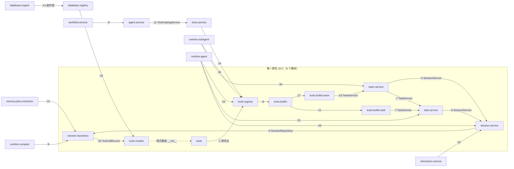

# 解除循环导入 — 技术设计

> 所有行号在 2026-08-28 于 `feature/unify-llm-client` 分支 HEAD `d25d600` 核实。

## 1. 导入图

### 1.1 跨包加载期图（只含模块级 import，省略 core/database/llm 叶子）



虚线边 `tools.models -.-> tools` 是 Python 导入机制的隐式行为：`import tools.models` 会先执行
`tools/__init__.py`。这条边把 ORM 层拉向 Service 层，是整个环里唯一"方向反了"的边。

### 1.2 进入点分析（为什么 main 不炸而 runtime.subagent 炸）

| 首个导入 | 先到达 | 结果 |
|---|---|---|
| `main` | `main.py:20 from tools.service` → `tools/__init__` → 整套工具 → `task.service` → `session.service` → `session.repository` → `tools.models`（此时 `tools` 已在 `sys.modules`，只是 `tools.models` 还没加载，直接加载成功） | 通过 |
| `runtime.agent` | `:14 agent.service` → `tools.service` → 同上 | 通过 |
| `runtime.subagent` | `:34 team.service` → `session.service` → `session.repository:20` → 触发 `tools/__init__` → ... → `task.service:6 from session.service import SessionService`，此时 `session.service` 半初始化 | **炸** |

结论：环的"安全入口"是 `tools` 包，任何从 `session`/`task`/`team` 侧进入的路径都炸；
而 `database.engine:14` 的副作用导入 `database.registry:35 -> tools.models` 同样会触发
`tools/__init__`，因此 `runtime.compact:9`、`memory.jobs.extraction:21` 这类只想拿
`SessionRepository` 的模块也被牵连。

## 2. 环边处置表

| 边 | 处置 | 改动文件:行号 | 理由 |
|---|---|---|---|
| `tools -> tools.registry`（`tools/__init__.py:1`） | **删除再导出** | `tools/__init__.py:1-3` 整体替换为 docstring | 唯一无消费者的边；删掉后跨包 SCC = 0 |
| `session.repository -> tools.models`（`:20`） | 保留 | — | Repository 引 ORM 合规；解环后此边只加载 `tools.models` |
| `session.service -> session.repository`（`:9`） | 保留 | — | 域内 Service→Repository |
| `task.service -> session.service`（`:6`） | 保留 | — | Service 调 Service |
| `team.service -> session.service`（`:5`）、`-> task.service`（`:7`） | 保留 | — | Service 调 Service |
| `tools.builtin.task -> task.service`（`:7`） | 保留 | — | 工具经 Service 操作本域表，合规 |
| `tools.builtin.team -> team.service`（`:18`） | 保留 | — | 同上 |

## 3. 候选方案对比

### 方案 A 最小改动：局部导入 + TYPE_CHECKING

把环上某条边改成函数内局部导入（例如把 `tools/builtin/task.py:7` 与 `tools/builtin/team.py:18`
的 `TaskService`/`TeamService` 挪到各 `run()` 内），类型注解用 `TYPE_CHECKING` 守卫。

- 优点：改动只在两个工具文件，不碰包结构。
- 缺点：
  1. 治标——环仍存在于代码结构中，只是把"炸"推迟到首次调用，任何人在别处再加顶层边就复活；
  2. 与本任务"清理局部导入绕行点"的目标背道而驰，会让局部导入从 19 处涨到 29 处；
  3. `TaskService` 在 10 处 `run()` 内构造（F2），每处都要写 import，重复且难维护；
  4. 上一任务记忆（feedback_no_silent_fallback）明确反对这类掩盖问题的写法。
- 改动面：2 文件约 12 行。风险：低但技术债增加。

### 方案 B 依赖倒置：工具不 import Service，由 ToolContext 提供工厂

在 `tools/base.py:16-28` 的 `ToolContext` 加 `service_factory` 之类的回调，由 `runtime/agent.py`
注入 `TaskService`/`TeamService` 构造器；`tools/builtin/task.py`、`team.py` 改为
`ctx.services.task(...)`。同理可让 `tools/builtin/agent.py:129` 不再反向依赖 `runtime.subagent`。

- 优点：架构上最干净，`tools` 包彻底成为叶子层，顺带解决保留的 `tools.builtin.agent` 局部导入。
- 缺点：
  1. 改动面大：`ToolContext` 构造点在 `runtime/agent.py`、`runtime/subagent.py`、`tools/service.py`
     多处，10 个工具 `run()` 全部要改，测试替身也要同步；
  2. 需要新设计一个"服务定位器"抽象，与 CLAUDE.md"Service 的 `__init__` 接受可选依赖，
     未注入回落工厂"的既有风格要统一，属独立的架构决策；
  3. 本任务的直接病因（F1）只需删一行就能根治，方案 B 是"顺便重构"，不是解环所必需。
- 改动面：约 8 文件 100+ 行。风险：中，涉及运行时注入链路。

### 方案 C 抽出共享底层模块

把 `session.repository` 需要的 `ToolCallRecord` 搬到 `core/` 或让 `session/repository.py:24-38`
的 `_SESSION_CHILD_MODELS` 改用字符串表名 + `Base.metadata.tables` 查找，避免直接 import
`tools.models`。

- 优点：`session.repository` 不再依赖 `tools` 包。
- 缺点：
  1. 治标不治本：`database/registry.py:35` 仍要 `from tools.models import ...`，
     而 `database/engine.py:14` 副作用导入 registry，任何拿 session 的路径依旧触发 `tools/__init__`；
  2. 违反 CLAUDE.md"ORM 按 feature 域放"的规则，`ToolCallRecord` 属 tools 域；
  3. 字符串表名查找失去类型检查。
- 改动面：2 文件约 20 行。风险：中，且**解不开** `database.registry` 这条路径。

### 推荐：方案 A' = 删除 `tools/__init__.py` 再导出 + 提升可安全提升的局部导入

不在 A/B/C 之内的第四条路，但改动量比 A 更小、效果比 B 更直接：
F1 证明整个 SCC 的成因是一条无消费者的包级再导出；删掉它，环即消失（副本已验证 F4）。
分层规约完全不动（AC3），保留的 8 处局部导入与本环无关，留给方案 B 的独立任务。

## 4. 推荐方案详细设计

### 4.1 `tools/__init__.py`（`:1-3` 全文替换）

```python
"""工具系统包入口。

刻意不再导出 ToolRegistry / build_tool_registry：database/registry.py 会导入 tools.models，
若此处再导出 registry，会把一次 ORM 导入放大成整套工具及其依赖的 Service，
形成 session.repository -> tools -> tools.builtin.* -> task/team.service -> session.service 的
加载期环。消费者一律 from tools.registry import ...。
"""
```

四处消费者本就直接导入 `tools.registry`（F1），无需改动。

### 4.2 局部导入处置表

| 位置 | 符号 | 处置 | 同步改动 |
|---|---|---|---|
| `session/service.py:89-90` | `DepartmentService`、`GroupService` | 提升到 `:7` 后顶层 | 折叠 `:144-149`、`:152-158` 两个嵌套 `if`（F5） |
| `session/service.py:146` | `DepartmentService` | 删除（顶层已有） | 同上 |
| `session/service.py:156` | `GroupService` | 删除 | 同上 |
| `session/service.py:223-224` | 两者 | 删除 | — |
| `session/service.py:345,367` | `AgentService` | **保留**，加注释 | 注释：`agent.service -> tools.service -> tools.registry -> tools.builtin.task -> task.service -> session.service` |
| `session/service.py:349,371` | `WorkflowService` | **保留**，加注释 | 注释：经 `workflow.service:8 -> agent.service` 同上 |
| `auth/service.py:58,102` | `WorkspaceService` | 删除（`:12` 顶层已有） | — |
| `runtime/agent.py:1805-1807` | `AsyncSessionLocal`、`SubAgentRunner`、`TeamService` | 提升到顶层 import 块 | `tests/test_logging_chain.py:107-109` patch 目标改为 `runtime.agent.TeamService`、`runtime.agent.AsyncSessionLocal`、`runtime.agent.SubAgentRunner` |
| `skill/service.py:420` | `AgentService` | **保留**，加注释 | 注释：`agent.service:10 -> skill.service` 双向依赖 |
| `workspace/service.py:306` | `GroupService` | **保留**，加注释 | 注释：`group.service:11 -> workspace.service` 双向依赖 |
| `tools/builtin/agent.py:128-129` | `AsyncSessionLocal`、`SubAgentRunner` | **保留**，加注释 | 注释：`runtime.subagent:36 -> tools.registry -> tools.builtin.agent` |

`session/service.py:144-159` 折叠后形状：

```python
if session.shared_with_departments and await DepartmentService(self.db).is_department_in_shared_departments(
    workspace_id, membership.department_id, session.shared_with_departments,
):
    return True
```

（按 100 字符行宽换行；`await` 在 `and` 右侧短路求值，语义与原嵌套 `if` 完全一致。）

### 4.3 测试侧

- `tests/test_events_actor.py`：`:202` 的 `from runtime.subagent import SubAgentRunner` 移到 `:24-25`
  的顶层 import 块（ruff I001 会要求排在 `tools.subagents.definition` 之前），删除 `:199-200` 注释，
  docstring `:197-201` 只保留第一句。
- `tests/test_neutral_context.py`：删除 `:14-19`（4 行注释 + `import tools  # noqa: F401`）。
- `tests/test_logging_chain.py:107-109`：patch 目标改到 `runtime.agent.*`（见 4.2）。

### 4.4 spec 回写

`.trellis/spec/backend/directory-structure.md:155`"包导出：`__init__.py` 导出该域的 Service 和
主要 Schema"后补一句：基础设施包（`tools/`、`database/`、`core/`）的 `__init__.py` 不做再导出，
避免 ORM 导入连带触发上层 Service。`:324-347` tools 段补"`tools/__init__.py` 刻意留空"说明。

## 5. 回归测试设计：`tests/test_import_isolation.py`

原型已在副本跑通（修复后 16 passed；放回未修复主仓库 9 failed / 7 passed）。

### 5.1 模块枚举 helper

```python
PROJECT_ROOT = Path(__file__).resolve().parent.parent

def _first_party_modules() -> list[str]:
    """遍历顶层含 __init__.py 的包 + main，跳过 tests/alembic 与 versions 目录。"""
```

返回 168 个模块名；`__init__.py` 映射为包名本身。

### 5.2 用例一：静态 SCC（毫秒级，默认跑）

`test_no_module_level_import_cycles`：AST 解析每个文件，只收集模块级（含 `if`/`try` 内，
排除 `TYPE_CHECKING` 块和函数体）的 `Import`/`ImportFrom`；`from a.b import c` 若 `a.b.c`
是已知模块则目标为 `a.b.c`，否则为 `a.b`；目标的每一级祖先包都记为边，**但当前模块自身的
祖先包不算**（子模块回引父包时父包必已在 `sys.modules`，这是 `llm`/`plan`/`prompt` 自环
不炸的原因）。Tarjan 求 SCC，断言 `len(comp) > 1` 的分量为空，失败时打印各分量成员。

### 5.3 用例二：哨兵模块子进程探测（参数化，默认跑）

```python
FIRST_IMPORT_MODULES: tuple[str, ...] = (
    "session.repository", "session.service", "task.service", "team.service",
    "interaction.service", "runtime.subagent", "runtime.compact",
    "memory.jobs.extraction",            # 修复前全部炸
    "runtime.agent", "runtime.workflow", "tools.registry", "tools.builtin.agent",
    "database.registry", "api.router", "main",   # 主要入口
)

@pytest.mark.parametrize("module", FIRST_IMPORT_MODULES)
def test_module_imports_cleanly_as_first_import(module: str) -> None:
    result = subprocess.run(
        [sys.executable, "-c", f"import {module}"],
        cwd=PROJECT_ROOT, capture_output=True, text=True, timeout=60,
    )
    assert result.returncode == 0, f"模块 {module} 作为首个导入失败:\n{result.stderr.strip().splitlines()[-1:]}"
```

实测串行 15 个约 14s（每个子进程 ~1s，主要是 SQLAlchemy/pydantic 加载）。

### 5.4 用例三：全量并行兜底（默认跑，Q1 若用户要求可加 slow 标记）

`test_all_first_party_modules_import_cleanly`：`ThreadPoolExecutor(max_workers=8)` 对 168 个
模块并行起子进程，收集所有失败项一次性断言，失败信息含模块名 + stderr 末行。实测 ~19s。

### 5.5 为什么三层都要

- 静态用例快、能定位"哪几个模块成环"，但对 `importlib`/动态导入无感；
- 哨兵用例保证历史踩过的 8 个坑逐个有名字，失败时一眼看出是哪个；
- 全量用例覆盖新增模块，防止漏出哨兵清单。

## 6. 兼容性与回滚

- **对外接口**：`tools` 包不再导出 `ToolRegistry`/`build_tool_registry`；全仓无消费者（F1），
  外部若有 `from tools import ToolRegistry` 的写法会在导入时 `ImportError`，属显式失败，
  符合"无静默兜底"。
- **运行时行为**：所有改动都是导入位置的搬移，不改任何函数体逻辑；`session/service.py`
  的两处 `if` 折叠保持短路语义。
- **测试替身**：`test_logging_chain.py` 三处 patch 目标改到 `runtime.agent`，
  其余 monkeypatch 目标（F6）不受影响。
- **回滚**：单次提交，`git revert` 即可；`tools/__init__.py` 加回一行再导出环立即复活，
  静态 SCC 用例会在 0.1s 内报错，不会静默回退。

## 附录：研究用脚本形状

- 子进程探测：遍历模块列表 → `subprocess.run([sys.executable, "-c", f"import {m}"])` →
  收集 `returncode != 0` 的 `(模块, stderr 末行)`。
- 导入图：`ast.walk` 区分 `top` / `TYPE_CHECKING` / `local`（函数或方法体内）三类；
  只用 `top` 边建图；Tarjan SCC + 限长 DFS 枚举简单环；对每条 `local` 边做"若改顶层能否
  从目标回到源"的 BFS 可达性判断，结果即 prd F3 表。
