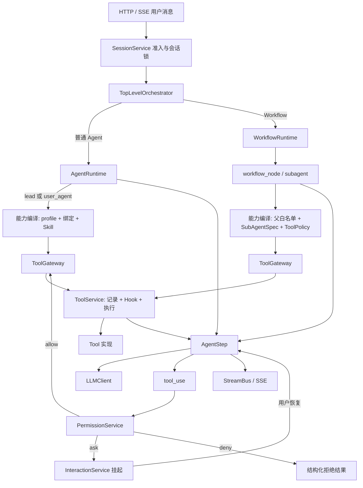
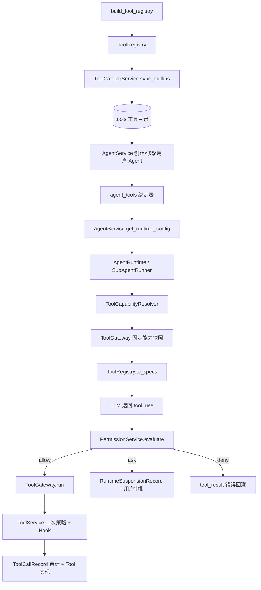
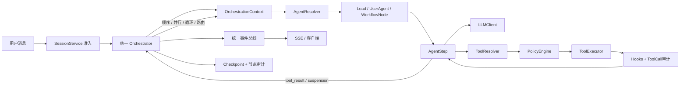

# AgentOS 工具治理与统一编排改造方案

本文是对 AgentOS 当前主 Agent、用户自建 Agent、SubAgent、Team 和 Workflow 运行机制的架构审计，重点回答两个问题：

1. 一个 Agent 在什么入口下可以看到、调用和审批工具；
2. 如何把现在分散的工具裁剪、权限判定和运行时循环改造成可维护的统一模型。

本文以当前代码为事实依据，不把“已经存在的局部 Workflow 编排器”误判成“已经有统一 Orchestrator”。

## 一、当前实现结论

本轮改造已经落地了四个基础边界：

1. `tools/policy.py` 用 `ToolPolicy` 和 `ToolProfile` 统一描述工具的可绑定、可调用、审批和 Skill 资产要求；
2. `tools/gateway.py` 用 `ToolGateway` 固定一次运行的 profile、可信身份、Agent ID、Skill 和 Shell 边界，正式运行时通过 `create` 或 `from_registry` 构造；
3. `runtime/step.py` 用 `AgentStep` 统一主 Agent、SubAgent、Workflow 节点和 teammate 的单次 LLM 调用；
4. `runtime/orchestrator.py` 用 `TopLevelOrchestrator` 统一 HTTP 消息进入普通 Agent Runtime 或 Workflow Runtime 的分发入口。

当前仍需继续演进的部分是：`TopLevelOrchestrator` 目前主要承担入口分发，Workflow 的顺序、并行和 LLM 路由编排器仍在 `runtime/workflow.py` 内实现；节点级持久化 checkpoint 和完整的组合 Agent 协议尚未完成。因此，当前状态是“工具执行边界已经统一，单步执行和顶层分发已经统一，控制流编排正在收口”，不是已经完成的通用图编排引擎。

本轮改造的核心顺序是：

```text
统一工具策略
    -> 抽取唯一 AgentStep
    -> 统一 Agent 协议
    -> 引入统一 Orchestrator
    -> 再开放更复杂的 Workflow / Team 能力
```

`AgentStep` 已经抽出，主 Agent、SubAgent 和 teammate 已接入；后续不要再为新的 Workflow 或 Team 能力复制一套 ReAct 循环。

### 1.1 当前运行时总图



## 二、当前真实的工具与运行时结构

### 2.1 工具从注册到执行的现状



这条链条中，`ToolRegistry` 只解决“代码里有什么工具”，不解决“谁可以用工具”。当前正式链路分成六个边界：

1. `ToolRegistry`：代码中实际存在的工具实现和输入 Schema；
2. `ToolCatalogService`：数据库中的可发现、可启用、可绑定目录项；
3. `ToolPolicy`：profile 级别的 bind/call/approval/Skill 规则；
4. `ToolCapabilityResolver`：把父白名单、Agent 绑定和 profile 编译成不可变的工具集合；
5. `ToolGateway`：固定一次运行的 profile、principal、Agent ID、Skill 和 Shell 资源边界；
6. `ToolService`：创建调用记录、触发 Hook、执行具体工具并写回结果。

`ToolCatalogService.require_bindable_tool_ids` 会检查以下条件：

- 工具目录记录存在；
- 工具已启用；
- `runtime_name` 在代码注册表中存在；
- 显式传入 profile 时，`ToolPolicy.can_bind` 允许该 profile 绑定。

用户自建 Agent 创建、更新和运行配置读取均显式使用 `profile="user_agent"`，因此 `Agent`、`TeamCreate`、`TeamSpawn`、`AskUserQuestion`、计划控制面等工具会在绑定阶段被拒绝，运行阶段还会再次由 `ToolCapabilityResolver` 和 `ToolGateway` 拒绝。

### 2.2 顶层用户 Agent 与子 Agent 的行为不同

用户创建的 `AgentRecord` 没有 `agent_type` 或 `execution_profile` 字段。它在顶层会话运行时由 `AgentRuntime` 装配：

```python
base_registry = build_tool_registry()
config = await AgentService(...).get_runtime_config(...)
self.tool_registry = base_registry.only(*config.tool_runtime_names)
```

所以顶层用户 Agent 的有效工具集合近似等于：

```text
代码注册表
∩ 用户绑定工具
∩ 工具启用状态
∩ user_agent 可绑定/可调用策略
∩ 已绑定 Skill 的资源边界
```

顶层用户 Agent 不再拥有主 Agent 控制面工具。主 Agent 使用 `lead` profile；用户 Agent 使用稳定身份 `agent:{agent_id}` 和 `user_agent` profile。`AskUserQuestion`、`Agent`、`TeamCreate`、`TeamSpawn`、计划控制面等工具在用户 Agent 的绑定阶段和运行阶段均被拒绝。主 Agent 的 Plan Mode 仍由 `AgentRuntime` 状态机切换工具集合，`AskUserQuestion` 由主运行时特殊处理并支持暂停和恢复。

Workflow 成员和 `Agent` 工具派生出的 SubAgent 则经过另一条路径：

```text
用户 Agent 配置
    -> 动态构造 SubAgentSpec
    -> GLOBAL_SUBAGENT_DENIED_TOOLS
    -> SubAgentSpec.resolve_tools
    -> PermissionService.evaluate(agent_type=runtime_name)
    -> ToolService.run
```

这条路径会强制去掉或由 profile 拒绝：

```text
Agent
TeamCreate
TeamSpawn
AskUserQuestion
EnterPlanMode
ExitPlanMode
WritePlan
```

子 Agent 没有人工审批恢复通道，所以危险工具的 `ask` 结果会转换成拒绝信息并回灌模型。当前运行时已经把 SubAgent、Workflow 成员和 teammate 分别标记为 `subagent`、`workflow_node`、`teammate` profile，并在父 Agent 白名单、SubAgentSpec 和 ToolPolicy 三层取交集。

### 2.3 当前各类工具的事实分类

| 工具类别 | 当前示例 | 当前实现位置 | 顶层主 Agent | 顶层用户 Agent | SubAgent / Workflow 成员 |
| --- | --- | --- | --- | --- | --- |
| 只读工具 | `Read`、`Glob`、`Grep`、`Weather` | `tools/builtin` | 可用 | 绑定后可用 | Explore/Plan/verification 默认可用 |
| 文件副作用 | `Write`、`Edit` | `tools/builtin` | 按权限审批 | 可以绑定，按 `PermissionService` 审批 | 由父白名单、Spec 和权限共同限制 |
| Shell | `Bash` | `tools/builtin/bash.py` | 按权限审批 | 默认不能绑定/调用 | 受 `ShellAccess`、profile 和权限双重限制 |
| 任务管理 | `TaskCreate`、`TaskGet`、`TaskUpdate`、`TaskList` | `tools/builtin/task.py` | 可用 | 绑定后可用 | 不属于全局禁用，是否可用取决于 spec 白名单 |
| 人工交互 | `AskUserQuestion` | `tools/builtin/ask_user_question.py` + `AgentRuntime` | 可用 | 不可绑定/调用 | 全局禁用，不能暂停等待用户 |
| 子 Agent 派发 | `Agent` | `tools/builtin/agent.py` | 可用 | 不可绑定/调用 | 全局禁用 |
| Team 控制面 | `TeamCreate`、`TeamSpawn` | `tools/builtin/team.py` | 可用 | 不可绑定/调用 | 全局禁用 |
| Team 消息 | `TeamList`、`SendMessage`、`ReadInbox`、`ListMessages` | `tools/builtin/team.py` | 可用 | 不可绑定/调用 | 仅 `teammate` 可用，其他 SubAgent / Workflow 节点不可用 |
| 计划控制面 | `EnterPlanMode`、`ExitPlanMode`、`WritePlan` | `tools/builtin/plan_mode.py` | 主运行时状态机处理 | 不可绑定/调用 | 全局禁用 |
| Skill 控制面 | `Skill`、`SkillResource`、`SkillRun` | `tools/builtin/skill.py` | 可用 | 绑定 Skill 后自动补齐 | 由 spec 和权限限制 |

`Task` 不是当前主 Agent 独有的工具。它属于会话任务状态操作工具，只要被加入某个 Agent 的有效工具集，顶层用户 Agent 也可以使用；内置 Explore/Plan/verification 因采用只读白名单，默认不能使用任务写入工具。

## 三、改造前为什么显得畸形

下面保留改造前的问题作为设计背景；其中工具权限、身份注入、统一单步执行和顶层分发已经按前文的当前实现收口，Team 的持久调度和节点级编排仍是后续工作。

### 3.1 能力声明和权限裁决混在一起

改造前至少有四种机制同时决定工具结果：

1. 用户 Agent 的 `agent_tools` 绑定；
2. `SubAgentSpec.allowed_tools` / `disallowed_tools`；
3. `GLOBAL_SUBAGENT_DENIED_TOOLS`；
4. `PermissionService` 的 `allow / ask / deny`。

它们的语义不同，但代码中没有统一对象表达。最容易产生的误解是“工具不在注册表里就是没有权限”，或者“工具被绑定了就一定能执行”。实际上，当前至少要区分：

```text
可发现（模型能否看到 schema）
可绑定（用户能否把工具放进 Agent）
可调用（当前身份和执行模式是否允许）
需审批（调用前是否要用户确认）
可恢复（是否有挂起点可以等待审批）
```

### 3.2 改造前用户 Agent 的身份没有进入策略模型

`AgentRecord` 只有提示词、模型和工具绑定，没有“这是顶层交互 Agent、Workflow 成员还是只读检索 Agent”的身份字段。Workflow 通过临时 `SubAgentSpec(agent_type=GENERAL_PURPOSE)` 桥接用户 Agent，导致：

- 同一 Agent 在不同入口有不同工具集；
- 不能用数据库约束防止用户绑定主控工具；
- 权限规则中的 `agent_type` 既表示能力档位，又被临时运行标识复用；
- “用户 Agent 是否允许继续派发”只能靠运行时黑名单兜底。

### 3.3 改造前三套循环重复实现同一件事

主 Agent、SubAgent、Workflow 成员都需要：

```text
构造消息
 -> 调用 LLM
 -> 解析流事件
 -> 处理 tool_use
 -> 执行工具
 -> 生成 tool_result
 -> 判断是否继续
```

这些逻辑现在分散在 `runtime/agent.py`、`runtime/subagent.py` 和 `runtime/workflow.py`。编排能力越多，重复越严重，权限、事件和错误语义就越容易分叉。

### 3.4 当前并行不是所有层面的并行

Workflow 的 `ParallelOrchestrator` 会并发启动多个成员，并为每个成员建立独立 `AsyncSession`，这一点是正确的。但主 Agent 同一批 tool_use 在 `_execute_tool_uses` 中仍按 `for` 顺序串行执行。Team 唤醒也不是统一的后台调度器。也就是说，当前的“Parallel”只在 Workflow 成员层成立。

### 3.5 改造前工具输入可以伪造运行身份

部分 Team 和 Task 工具把身份字段交给了模型输入：

- `SendMessage` 允许模型填写 `sender`；
- `ReadInbox` 允许模型填写 `recipient`；
- `TaskCreate` 和 `TaskUpdate` 允许模型填写 `owner`。

这类字段不能当作普通参数处理。模型可以生成任意字符串，因而可能冒充 lead、读取其他成员收件箱，或覆盖任务负责人。改造后应由 `ToolContext.principal` 注入真实身份，工具输入只保留业务目标：

```python
class Principal:
    actor_id: str
    role: str
    agent_id: int | None
    capabilities: frozenset[str]

# 工具执行时由网关注入
sender = ctx.principal.actor_id
owner = ctx.principal.actor_id
```

如果确实需要代理代替用户设置负责人或发送给指定成员，应将其设计成独立的受控 capability，并在策略层审计，而不是接受任意字符串作为身份。

## 四、当前工具治理模型与后续目标

### 4.0 已落地的执行链

当前一次工具调用的真实顺序是：

```text
ToolRegistry / ToolCatalog
    -> AgentService 或 SubAgentSpec 产生候选工具名
    -> ToolCapabilityResolver 按 profile 裁剪
    -> ToolGateway 固定 profile / principal / agent_id / Skill / Shell
    -> PermissionService 决定 allow / ask / deny
    -> ToolService 做策略二次校验、Hook、记录和执行
    -> ToolContext 注入可信身份
    -> ToolResult 回灌 AgentStep 或触发 InteractionService 恢复
```

这条链中有两个故意保留的兼容边界：`ToolService.run(profile=None)` 对未登记的扩展工具仍保留旧直接调用路径，正式 Runtime 不使用该路径；`ToolGateway` 的直接 dataclass 构造会做安全裁剪，正式 Runtime 使用 `ToolGateway.create` 或 `ToolGateway.from_registry` 进行严格构造。

### 4.1 用 ToolPolicy 表达工具能力

当前已使用代码级不可变策略声明；后续可以再把策略版本同步到数据库目录。
实现中的 `ToolPolicy` 明确区分“能否写入 Agent 配置”和“运行时能否调用”，并额外声明
是否需要审批、是否必须携带已绑定 Skill：

```python
@dataclass(frozen=True)
class ToolPolicy:
    name: str
    category: str
    bindable_profiles: frozenset[ToolProfile]
    callable_profiles: frozenset[ToolProfile]
    requires_approval: bool
    requires_bound_skill: bool
```

推荐的 `category`：

```text
LEAF          普通业务能力，如 Read、Weather、Task 查询
MUTATION      文件、Shell、外部系统等有副作用能力
INTERACTION   AskUserQuestion、计划审批
ORCHESTRATION Agent、TeamCreate、TeamSpawn、RunWorkflow
TEAM_MESSAGE  TeamList、SendMessage、ReadInbox
WORKFLOW      编排节点控制和路由能力
SYSTEM        仅运行时内部使用，不暴露给模型
```

### 4.2 用 ToolProfile 表达执行身份

用户 Agent 不应再只靠“绑定了什么工具”定义能力，而应绑定一个执行档位：

```python
ToolProfile = Literal[
    "lead", "user_agent", "workflow_node", "subagent", "teammate", "orchestrator"
]
```

建议默认策略：

| 执行档位 | 默认可见/可调用 | 默认禁止 |
| --- | --- | --- |
| `LEAD` | 业务工具、任务、Team、Agent、交互、计划 | 仅内部系统工具 |
| `USER_AGENT` | 只读工具、任务查询、显式绑定的普通业务工具 | `Agent`、`TeamCreate`、`TeamSpawn`、`AskUserQuestion`、计划控制面、`RunWorkflow` |
| `WORKFLOW_NODE` | 用户显式绑定的普通业务工具，按成员预算执行 | 所有编排、交互和 Team 创建能力 |
| `EXPLORE` | `Read`、`Glob`、`Grep`、受限 `Bash` | 写文件、SkillRun、任务写入、交互、派发 |
| `PLAN` | `Read`、`Glob`、`Grep`、受限 `Bash` | 写文件、任务写入、交互、派发 |
| `VERIFICATION` | 只读工具、受限临时目录 `Bash` | 写工程目录、交互、派发 |
| `ORCHESTRATOR` | 当前策略与 `LEAD` 同级，可调用普通工具、Team 消息、交互、Agent 和 Team 控制工具 | 当前 `TopLevelOrchestrator` 主要负责入口分发；后续可收紧为纯编排控制面 |

这里的关键是：用户 Agent 默认不拥有主控能力；如果产品确实需要“可编排用户 Agent”，应新增明确的管理员授予 profile，而不是让用户通过 `tool_ids` 绕过策略。当前 `orchestrator` profile 的策略集合与 `lead` 基本一致，是为顶层编排和后续恢复/调度预留的运行身份；`TopLevelOrchestrator` 当前并不直接调用模型工具，实际工具执行仍由 `lead`、`user_agent`、`workflow_node`、`subagent` 或 `teammate` 网关完成。若未来要把 `orchestrator` 收紧为纯控制面，应同步修改 `tools/policy.py` 和测试，不能只修改文档。

### 4.3 工具解析与网关是独立步骤

当前流程已经采用以下显式分层；`ToolResolver` 在代码中对应 `ToolCapabilityResolver`，`ToolExecutor` 的执行职责由 `ToolGateway + ToolService` 组合承担：

```text
ToolResolver.resolve_candidates(
    agent_profile,
    explicit_bindings,
    execution_mode,
    workspace_scopes,
)
    -> 可见工具集合

PolicyEngine.decide(
    actor,
    tool,
    tool_input,
    session_rules,
    workspace_rules,
    budgets,
)
    -> PolicyDecision(allow / ask / deny, reason, resumable)

ToolExecutor.run(
    decision,
    tool,
    context,
)
    -> ToolResult + ToolCallRecord + Hook 事件
```

最终工具集合必须满足：

```text
代码注册表
∩ 工具已启用
∩ Agent 显式绑定（或 profile 默认工具）
∩ profile 可绑定/可调用策略
∩ 当前执行模式
∩ 工作区和会话 scope
∩ 预算与审批状态
```

“未注册”只能表示实现不存在；“被策略过滤”必须返回可审计的 reason，不能继续用空集合静默表达。

### 4.4 可绑定、可调用和可见不是同一个状态

`ToolCapabilityResolver.resolve_bindable_names()` 用于创建或修改 Agent 时校验显式绑定，
`resolve_names()` 用于运行时生成模型可见且可调用的注册表。两者故意分开：

```text
用户 Agent 显式 tool_ids
    -> resolve_bindable_names(user_agent)
    -> 写入 agent_tools

运行时 Agent 配置 + 已启用 Skill
    -> 自动补齐 Skill / SkillResource / SkillRun
    -> resolve_names(user_agent)
    -> ToolGateway.registry.to_specs()
```

因此 `SkillRun` 在用户 Agent 中是“可由已授权 Skill 自动注入并调用”，不是“用户可以直接把
SkillRun 写进 tool_ids”。`ToolService` 执行时还会用 `allowed_skill_names` 检查实际脚本所属
Skill，防止旧配置、伪造 tool_use 或直接调用绕过 Skill 资产边界。模型可见性由最终网关注册表
决定，不能只根据数据库绑定表推断。

### 4.5 权限规则的作用域与审批链

工具策略只回答“这个身份有没有资格使用能力”，`PermissionService` 再回答“这一次调用是
allow、ask 还是 deny”。优先级为：

```text
session 规则 > 当前 workspace 的 global 规则 > 内置 profile 默认值 > 工具风险默认值
```

当前 API 已要求登录用户和工作区上下文：全局规则只能由工作区 owner/admin 维护，会话规则只
能由会话创建者维护。`permission_rules.workspace_id` 用于隔离不同工作区；迁移前遗留的
`workspace_id IS NULL` 全局规则不会在带工作区的运行时查询中生效，需要管理员按工作区重新配置。
删除规则时还会校验规则所属工作区，避免仅凭 rule_id 跨租户删除。

默认审批行为直接从 `TOOL_POLICIES.requires_approval` 派生：`Write`、`Edit`、`Bash` 和
`SkillRun` 默认 `ask`，只读工具默认 `allow`。`verification` 子代理对 `Bash` 有内置
`allow`，但仍受 `ShellAccess.TMP_WRITABLE` 等资源边界限制；子代理没有人工审批恢复通道，
所以普通 `ask` 会转换为结构化拒绝结果而不是无限挂起。

### 4.4 绑定阶段和执行阶段都要检查

创建或修改用户 Agent 时，`AgentService` 应调用：

```python
ToolPolicyService.require_bindable(
    profile="user_agent",
    tool_ids=tool_ids,
    workspace_scopes=scopes,
)
```

运行时仍然要再次调用 `ToolResolver` 和 `PolicyEngine`，原因是：

- 工具可能在 Agent 创建后被停用；
- 工作区权限可能变化；
- 会话可能处于 Plan Mode、Workflow 或只读恢复状态；
- 工具审批状态和预算是动态的。

绑定检查防止错误配置进入系统，运行检查防止旧配置和动态上下文绕过安全边界。

## 五、统一 Orchestrator 的目标结构

### 5.1 唯一 AgentStep

先从三个运行时抽取一次 LLM + 工具执行的单步原语：

```python
@dataclass(frozen=True)
class StepRequest:
    messages: list[dict[str, Any]]
    system_blocks: list[Any]
    tools: ToolRegistry
    model: str | None
    actor: Actor
    context: ToolContext


@dataclass(frozen=True)
class StepResult:
    content: list[dict[str, Any]]
    text: str
    tool_uses: tuple[ToolUse, ...]
    usage: Usage | None
    stop_reason: str | None
    suspension: SuspensionSignal | None
```

`AgentStep` 只负责一次模型调用、流事件装配、工具决策和工具结果返回；它不负责 ReAct 是否继续、数据库最终提交、Workflow 节点调度或恢复游标。

### 5.2 统一 Agent 协议

```python
class Agent(Protocol):
    name: str

    def run(
        self,
        ctx: OrchestrationContext,
    ) -> AsyncIterator[StreamEvent]:
        ...
```

下面几类对象都实现同一个协议：

- `LeadAgent`：拥有用户交互入口和编排权限；
- `ConfiguredAgent`：由 `AgentRecord` 转换而来；
- `SubAgent`：内置 Explore/Plan/verification 或受限用户 Agent；
- `SequentialAgent`、`ParallelAgent`、`LoopAgent`、`RoutingAgent`：组合子；
- `WorkflowNode`：持久化 Workflow 节点的适配器。

### 5.3 OrchestrationContext 统一状态和恢复

```python
@dataclass
class OrchestrationContext:
    run_id: UUID
    session_id: int
    turn_id: UUID
    actor: Actor
    state: dict[str, Any]
    cursor: str | None
    budget: Budget
    bus: StreamBus
    cancellation: CancellationToken
```

建议新增两类审计记录：

```text
orchestration_runs
orchestration_node_runs
```

每个节点至少记录 `run_id`、节点 ID、输入摘要、状态、开始/结束时间、错误码、输出引用和恢复游标。这样 Workflow、Team 和未来的路由都可以复用同一套恢复语义。

### 5.4 编排图



编排器只负责控制流：选择下一个节点、并发、状态合并、预算和恢复。它不再复制 LLM 调用和工具执行循环。

## 六、迁移进度与下一步

### 阶段 0：补回归测试网（已完成第一批）

在改动运行时之前先恢复最小测试集，至少覆盖：

- 顶层主 Agent 无工具、有只读工具、有危险工具；
- 用户 Agent 绑定 `AskUserQuestion`、`Agent`、`TeamCreate` 时的拒绝行为；
- Plan Mode 工具切换；
- 子 Agent 的全局禁用工具；
- `ask` 在主 Agent 中挂起、在子 Agent 中拒绝；
- Workflow 顺序、并行、路由；
- 租约丢失、取消、恢复和重复提交。

当前已增加 `test_tool_policy.py`、`test_tool_gateway.py`、`test_tool_identity.py`、
`test_permission_service.py`、`test_agent_step.py`、`test_budget.py` 和
`test_orchestrator_context.py`，覆盖工具矩阵、网关快照、权限默认值与规则优先级、身份注入、
单步执行、预算和 checkpoint 基础行为。后续仍应补充 Agent 删除后的会话行为以及节点级恢复。

### 阶段 1：修正身份和枚举（核心路径已完成）

- 统一 `general-purpose` 与 `general_purpose`，不要在运行时散落字符串转换；
- 用户 Agent 当前由运行时固定为 `user_agent`，尚未把 profile 持久化到 `AgentRecord`；若未来允许管理员授予更高 profile，再增加显式字段和版本校验；
- 把“能力档位”和“运行标识”分开，不能继续让 `agent_type` 同时承担两种语义；
- 在配置和事件中使用显式 `agent_id`、`profile`、`actor_role`。

### 阶段 2：落地 ToolPolicy 和 ToolResolver（已完成第一版）

第一版已经用代码声明完成：

1. 建立 `ToolPolicy` 和 `TOOL_POLICIES`；
2. 修改 `ToolCatalogService.require_bindable_tool_ids`，拒绝 profile 不允许绑定的工具；
3. 修改 `AgentRuntime._configure_agent` 和 `SubAgentRunner._resolve_tools`，统一走 resolver；
4. 通过 `ToolGateway` 固定运行身份并在 `ToolService` 做二次策略校验；
5. 把拒绝结果写入工具调用记录并触发 Hook。

### 阶段 3：抽取 AgentStep（已完成第一版）

`runtime/step.py` 已提供 `AgentStep`，主 Agent、SubAgent 和 teammate 已共用一次 LLM 调用与流事件装配原语。ReAct 的继续条件、工具审批、提交和恢复仍由各自运行时负责。

### 阶段 4：统一 Agent Protocol 和 OrchestrationContext（第一版已完成）

`runtime/orchestrator.py` 已提供 `Orchestrator` 协议、`OrchestrationContext`、checkpoint 和
`TopLevelOrchestrator`。HTTP 消息入口已经统一由 TopLevelOrchestrator 分发到 AgentRuntime 或
WorkflowRuntime；Workflow 的 Sequential、Parallel、LLM Routing 仍由 `runtime/workflow.py`
中的具体编排器负责。Loop、节点级持久化和后台队列尚未完成，不能把当前实现描述成完整的 durable
图编排引擎。

### 阶段 5：打通用户 Agent、Workflow 和 Team（工具边界已完成，调度仍进行中）

用户 Agent、Workflow 节点、SubAgent 和 teammate 已使用不同 `ToolProfile` 进入同一个
ToolGateway；Task 工具不属于主 Agent 独有能力，Team 消息工具则只开放给 lead/orchestrator/
teammate，用户 Agent 明确不可绑定或调用这些工具。Workflow 成员当前仍通过 `SubAgentSpec` 适配数据库 Agent，Team 仍是数据库成员、
消息、任务和请求内唤醒机制，不是独立的后台调度器。下一步应把 `AgentRecord` 转换成统一的
`ConfiguredAgent`，并为 Team 增加持久节点运行记录、重试和恢复。

### 阶段 6：逐步开放编排 API（尚未开始）

最后才提供 Workflow 图编辑、节点路由、并行策略、循环预算和恢复接口。每个节点都必须声明 profile、工具策略、输入输出键和失败策略。

## 七、改造完成的验收标准

达到以下条件后，工具与编排模型才算真正统一：

1. 用户 Agent 不能通过 `tool_ids` 绑定 `Agent`、`TeamCreate`、`TeamSpawn`、`AskUserQuestion` 或 `RunWorkflow`，除非显式拥有管理员授予的 Lead/Orchestrator profile；
2. 任何执行入口都通过同一个 `ToolResolver` 得到工具集合；
3. 任何工具执行都通过同一个 `PolicyEngine` 和 `ToolExecutor`；
4. `AskUserQuestion` 的“可挂起”是 profile 能力，不是工具名被特殊识别后才偶然生效；
5. SubAgent 没有审批通道时，所有 `ask` 都有结构化拒绝结果，不会绕过审批；
6. 主 Agent、SubAgent、Workflow 成员的单步 LLM 和工具循环来自同一个 `AgentStep`；
7. Sequential、Parallel、Loop、Routing 都实现同一个 Agent 协议；
8. 编排节点有独立运行记录和恢复游标，取消、失败和重试不会靠内存状态猜测；
9. 工具可见、可绑定、可调用、需审批四种状态可以单独审计；
10. 仅通过工作区管理员授予的 profile 才能获得编排和人工交互能力。

## 八、给复刻项目的最小落地版本

如果要让其他程序员或 AI 复刻，可以按下面的最小闭环实现，而不是一次性复制整个 AgentOS：

```text
ToolDescriptor
    name / schema / category / risk / profiles / approval

ToolResolver
    根据 profile + bindings 生成 LLM 可见工具

PolicyEngine
    根据 actor + scope + session rule 返回 allow / ask / deny

AgentStep
    一次 LLM 调用 + 一批工具结果

Agent
    一个可流式运行的统一协议

Orchestrator
    sequential / parallel / routing 三种组合子

Checkpoint
    run + node_run + cursor + suspension
```

实现顺序保持：先让工具边界可证明，再让 AgentStep 可复用，最后让 Orchestrator 负责控制流。这样才能避免当前项目“顶层 Agent 能做很多事、子 Agent 又被另一套黑名单裁剪、Workflow 再复制一套运行逻辑”的分裂状态。

## 九、当前实现的两个安全不变量

### 9.1 Skill 白名单必须随运行身份收紧

`Skill`、`SkillResource` 和 `SkillRun` 属于 Skill 资产访问工具。`lead` 运行身份可以按工作区
目录访问已启用 Skill；`user_agent`、`workflow_node`、`subagent`、`teammate` 和
`orchestrator` 必须由父运行时显式传入 `allowed_skill_names`。缺少白名单、白名单为空或名称不
在白名单中时，工具网关和工具实现都会拒绝调用。这样可以防止子代理在调用方漏传参数时默认读到
整个工作区的 Skill。

Skill 的工具实现仍保留 `profile=None` 的兼容行为，用于旧测试和内部目录操作；正式 Agent 运行
始终由 `ToolService` 注入 profile，因此不能把这个兼容行为当作正式授权路径。

### 9.2 正式运行的工具执行入口只有 ToolGateway

运行时应遵循以下不变量：

```text
模型 tool_use
    -> 当前 Runtime 的能力检查
    -> PermissionService（allow / ask / deny）
    -> ToolGateway.run
    -> ToolService（二次策略、Hook、审计、实现调用）
```

主 Agent 在创建人工交互挂起点时，也通过 `ToolGateway.start_call` 建立 `ToolCallRecord`，从而
让 profile、principal、agent_id 的归属保持一致。`ToolService` 仍保留直接调用接口，仅用于旧扩展
点和测试替身；新的 Runtime、Workflow 和 Team 代码不得绕过 Gateway。

## 十、给复刻实现者的最小模块清单

复刻项目可以按下面的顺序实现，先形成可验证的安全闭环，再增加 Team 和 Workflow：

```text
1. ToolDescriptor / ToolRegistry
   工具名称、输入 Schema、风险分类和实现注册。

2. ToolPolicy / ToolProfile
   分开描述可发现、可绑定、可调用、需审批和 Skill 资产要求。

3. ToolResolver
   用 profile、Agent 显式绑定、父节点白名单和工作区状态编译最终工具集。

4. ToolGateway
   固定 principal、profile、agent_id、Skill 白名单、Shell 目录；调用时不可被模型输入覆盖。

5. PolicyEngine
   对一次调用返回 allow / ask / deny；ask 必须声明是否可恢复。

6. AgentStep
   只做一次 LLM 流调用和事件装配；主 Agent、子 Agent、Workflow 节点共用。

7. AgentRuntime / SubAgentRunner
   负责 ReAct 循环、消息持久化、工具结果回灌和交互恢复。

8. Orchestrator
   负责顺序、并行、路由、循环、节点预算和 checkpoint，不复制 AgentStep。

9. TeamScheduler（后续）
   把 Team 成员唤醒从请求内循环升级成持久队列、节点运行记录、重试和取消协议。
```

当前 AgentOS 已完成第 1 至第 8 项的第一版基础设施，但第 8 项仍是“顶层分发器 + 局部
Workflow 编排器”，第 9 项尚未完成。因此复刻时应明确把 Team 调度器和 durable Workflow 引擎
作为后续阶段，不能把现有请求内唤醒机制误认为后台多 Agent 平台。
