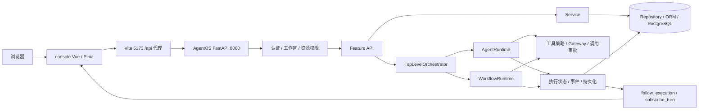
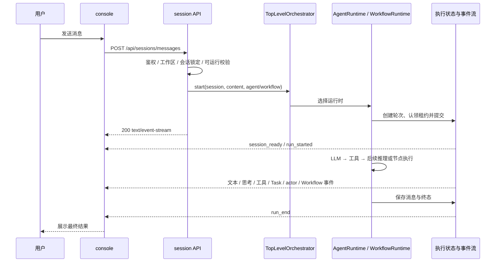
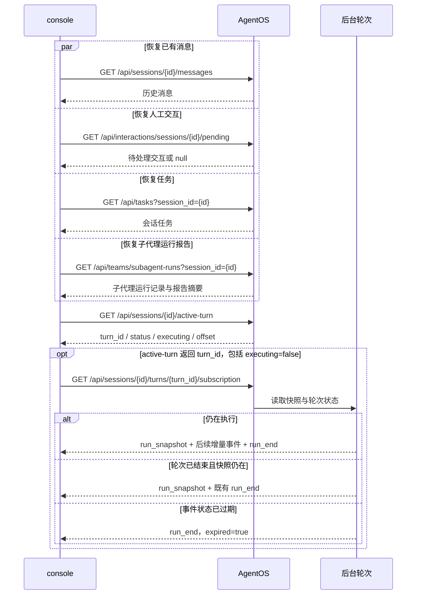
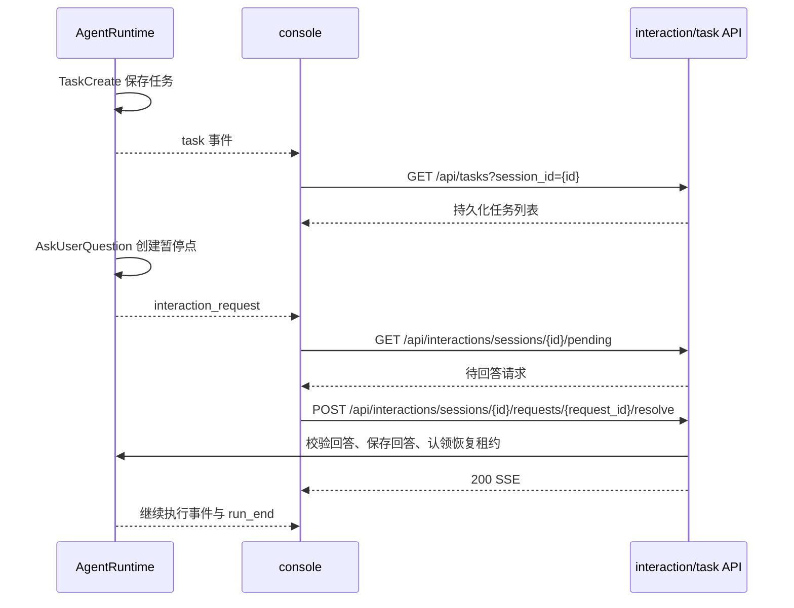
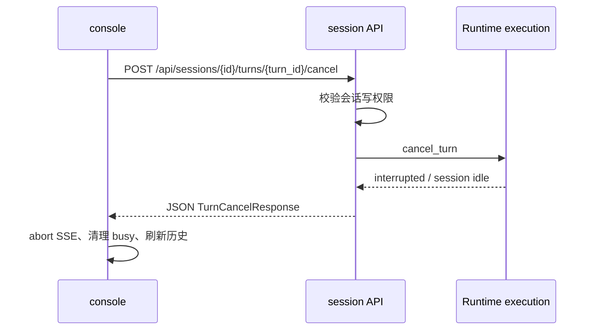

# AgentOS 与 console 接口对接审计

审计日期：2026-11-01。本文记录本轮代码核对、修复及实际联调结果，供开发者和后续复刻使用。

## 1. 项目范围与结论

- **后端**：`/Users/xianglei/Documents/develop/code/python/AgentOS`。
- **前端**：`/Users/xianglei/Documents/develop/code/python/console`。
- **HugAgentOS**：当前会话的初始工作目录，不是本次 console 应对接的后端。
- **实际链路**：浏览器 → console 的 Vite `5173` → `/api` 代理 → AgentOS FastAPI `8000`。代理配置见前端 `vite.config.ts`。

消息、Agent、Workflow、Skill、任务、人工交互、取消和恢复已经按 AgentOS 的实际契约核对。后端入口已通过 `TopLevelOrchestrator` 统一分发普通 Agent 与 Workflow；这不代表所有编排能力都已经重写成统一的持久化工作流引擎。

仍需区分：Team 运行记录接口不等于 Team 配置管理 API；设置页中的模型、渠道、自进化、服务目前是 mock；旧 orchestration-plan CRUD 不在 AgentOS 路由中。

## 2. 总体架构



后端根路由是 `api/router.py`；HTTP 层负责参数、鉴权和响应，业务 Service/Repository 维持 feature 分层。执行结果通过 SSE reducer 写入前端消息、任务、工具和 Workflow 状态。

## 3. 三类响应契约

### 3.1 普通 JSON

后端 `core/responses.py` 定义普通 API 的统一信封：

```json
{"data": {}, "error": null, "request_id": "请求标识"}
```

错误信息使用 `error.code`、`error.message`、`error.details`，其中 `error.code` 目前为可选字段，后端暂不输出。前端 `src/http/index.ts` 的 `request<T>` 解包 `data`，`errorFromBody` 解析信封错误并兼容已有顶层 `message/detail/code`。Skill zip 导出使用 `requestBlob`。

### 3.2 认证原始 JSON

`POST /api/auth/register`、`/login`、`/refresh`、`/switch-workspace` 返回 `AuthResponse` 或 `TokenResponse` 原始 JSON，没有普通 `data` 外壳。前端使用 `authRequest` 处理，不能按普通资源响应解包。

业务请求通过 `Authorization: Bearer ...` 鉴权，前端从 `localStorage.auth_token` 读取令牌。本文不记录账号、密码、令牌或连接串。

### 3.3 SSE

`src/http/console.ts` 的 `streamPost`/`streamGet` 使用 `fetchEventSource`：

- `onopen` 校验 HTTP 状态和 `text/event-stream`；JSON 业务拒绝转成保留状态、错误码和详情的 `SseOpenError`。
- `onmessage` 解析 JSON，忽略空帧和 `[DONE]`。
- `onerror` 上报并抛出，禁止库静默重发 POST 消息。
- `abort()` 关闭连接；后台执行取消必须走显式 cancel API。
- `run_end` 是轮次终态；网络连接关闭本身不是执行完成。

## 4. 消息发送与执行节点

统一入口为 `POST /api/sessions/messages`，Schema 是 `session/schemas.py` 中的 `SessionSendMessageRequest`，字段为可选 `session_id`、`agent_id`、`workflow_id` 与必填 `content`。未知字段被拒绝，旧 `orchestration_plan_id` 不再接受。

`agent_id` 与 `workflow_id` 互斥。新会话可以选择其一；已有会话不能换绑。前端续聊不重复提交新的选择 ID，后端根据请求和已锁定会话解析有效 Workflow，保证第二轮仍使用原 Workflow。



准入在 SSE 返回之前完成，让权限、冲突和配置错误维持 HTTP JSON 错误语义。`follow_execution(handle)` 跟随后台执行，连接断开不自动取消后台任务。主要证据为 `session/api.py`、`runtime/orchestrator.py`、`runtime/execution.py`、`runtime/turn_follow.py`。

## 5. 恢复、任务、人工交互和取消

### 5.1 页面重建与断流恢复



历史、pending、tasks 和 subagent-runs 采用 `Promise.allSettled`，单个辅助查询失败不会阻断其他结果。已删除任务被过滤。任务接口是 `/tasks?session_id=...`，不是 `/sessions/{id}/tasks`。

子代理历史通过 `src/http/session-runtime.ts` 接入，`src/utils/session-runtime.ts` 按后端 run_id 映射为 `run-{id}`，区分同名多次运行，将成功/失败状态、报告摘要和错误信息补回侧栏。REST 只补当前尚缺的运行，不覆盖实时 SSE 中已收到的推理、工具和回答；它恢复的是运行记录与报告摘要，不是完整的逐事件历史。

`hydrateRunSnapshot` 用快照恢复正文、思考、工具、任务、actors 和 Workflow 进度：完整快照替换同轮助手内容，截断快照保留数据库历史。恢复助手消息通过 Vue reactive 代理接收增量，避免状态已变但界面不更新。

切页/切工作区只关闭本页订阅。数据代次、流代次、session_id 和 turn_id 一起约束回调，避免旧流污染新页面。意外断流最多恢复三次并递增延时；4xx 建流错误直接展示，不无限续订阅。

**已结束轮次也恢复一次快照**：active-turn 只要返回 turn_id，即使 executing=false，前端也会订阅一次，以补回快照中的 errors、Workflow 执行图和 actors。此时 busy=false，不阻止发送新消息；新轮次的代际守卫会拦截迟到的旧回调。

终态恢复沿用既有后端契约：状态仍存在时发 run_snapshot + run_end；状态已过期时只发带 expired=true 的 run_end。没有新增 SSE 事件，也没有改动后端终态协议。普通实时流收到 run_end 后先对齐 REST 历史，再恢复一次终态快照；该次终态订阅收尾不再发起 REST 刷新，避免“刷新 → 订阅 → run_end → 再刷新”的递归。相关实现为 console/src/stores/console.ts 的 recoverActiveTurn、hydrateRunSnapshot、finalizeStream，以及 AgentOS/runtime/turn_follow.py 的 subscribe_turn。

### 5.2 Task 与人工交互



resolve 的校验、回答落库和租约认领在建流前完成；客户端断开不会取消恢复执行。取消人工暂停点使用 `POST /api/interactions/sessions/{id}/suspensions/{suspension_id}/cancel`，返回普通 JSON，与取消执行轮次分开。

### 5.3 显式取消执行



## 6. 接口矩阵

所有路径均以 `/api` 为前缀。状态描述的是实际接入程度，不表示每个分支都做过真实模型调用。

| 能力 | 后端契约 | 前端入口 | 状态与说明 |
|---|---|---|---|
| 认证 | `/auth/register/login/refresh/switch-workspace` | `src/http/index.ts` 的 authRequest | 已接，原始 JSON |
| Agent CRUD | `/agents`，`agent/api.py` | `src/http/agent.ts` | 已接 |
| Agent 绑定 | `PUT /agents/{id}/tools`、`/skills` | `src/stores/agents.ts` | 已接，按集合比较差异保存 |
| 工具目录 | `/tools`，`tools/api.py` | `src/http/tool.ts` | 已接，含 bindable_profiles |
| Skill | 列表、详情、JSON 更新、zip 上传/校验/替换/导出、启停、删除 | `src/http/skill.ts` | 已接 |
| Workflow | CRUD 与模式元数据，`workflow/api.py` | `src/http/workflow.ts` | 已接 |
| 会话与历史 | `/sessions`、`/{id}/messages`，重命名/共享/归档/删除 | `src/http/console.ts` | 已接 |
| 消息执行 | `POST /sessions/messages` | sendMessage | 已接，SSE |
| 恢复 | `/{id}/active-turn`、`/{id}/turns/{turn_id}/subscription` | getActiveTurn / subscribeTurn | 已接；执行中续播，已结束轮次补一次快照，过期时仅 run_end |
| 任务 | `GET /tasks?session_id=...` | getSessionTasks | 已接 |
| 人工交互 | pending / resolve / suspension cancel | getPendingInteraction / respondInteraction / cancelInteraction | 已接 |
| 轮次取消 | `POST /sessions/{id}/turns/{turn_id}/cancel` | cancelTurn | 已接 |
| 工具权限 | `/permissions` GET/POST/DELETE | 工具权限设置 | 已接，global 操作需 owner/admin，迁移 0026 已应用 |
| 用户资料 | `/users/me` | `src/http/settings/profile.ts` | 已接，真实持久化 |
| Team 成员 | `GET /teams/members?session_id=...` | 没有专用 REST 接入 | 未接；实时 SSE 展示不等于历史查询已接 |
| Team 消息 | `GET /teams/messages?session_id=...` | 没有专用 REST 接入 | 未接 |
| 子代理运行与报告历史 | `GET /teams/subagent-runs?session_id=...` | `src/http/session-runtime.ts`、`src/utils/session-runtime.ts`，由 console store 加载 | 已接；补回运行状态、报告摘要和错误，保留已有实时详情 |
| 会话计划 | `GET /plans/{session_id}` | 仅交互卡展示待审批计划 | 独立查询未接；不是旧 orchestration-plan CRUD |
| Team 配置管理 | 后端没有对应 CRUD | `src/stores/teams.ts` | mock：RESOURCE_PAGES 种子与内存 CRUD，TEAM-xxxx ID |
| 模型设置 | 后端没有对应管理 API | `src/http/settings/models.ts` | mock：种子、内存、模拟连通性；默认模型偏好未落库 |
| 渠道设置 | 后端没有对应管理 API | `src/http/settings/channels.ts` | mock |
| 自进化设置 | 后端没有对应管理 API | `src/http/settings/evolution.ts` | mock |
| 服务设置 | 后端没有对应管理 API | `src/http/settings/services.ts` | mock |
| 旧编排方案 | 后端没有 `/orchestration-plans` | `src/http/orchestration-plan.ts` 等 | 死代码：正常入口已重定向 Workflow，旧 HTTP/类型/store/组件仍待清理 |

设置 mock 文件注释中的 `/v1/...` 是拟议契约，不是 AgentOS 已实现的路由。Team REST 当前查询的是会话运行记录，不能直接充当前端 Team 配置页的资源 API。

## 7. 工具边界及本轮修复

### 7.1 服务端治理边界

`ToolRegistry` 负责“代码中存在的工具”；`tools/policy.py` 负责“哪些运行身份可绑定、可调用”；权限服务处理调用级规则和审批。身份包括 lead、user_agent、workflow_node、subagent、teammate、orchestrator。未知工具默认拒绝。

用户创建和替换 Agent 工具绑定时，统一按 user_agent 校验。`Skill`/`SkillResource`/`SkillRun` 还要求已绑定 Skill 白名单；可调用不等于可显式绑定。副作用工具仍有调用级审批，不能用前端选项代替服务端授权。

### 7.2 本轮具体改动

- `tools/schemas.py` 给目录列表和详情统一增加计算字段 bindable_profiles，直接读取 tools/policy.py，不另建前端策略表，也无需为该字段迁移数据库。
- `tools/service.py` 对停用工具新增绑定返回 409、策略禁止绑定返回 403；`agent/service.py` 创建/替换绑定使用 user_agent 身份。
- `console/src/interfaces/tool/model.ts` 和 `src/utils/agent-tools.ts` 消费策略元数据：缺元数据默认不能新增；受限/停用的遗留已绑定项仍显示并可取消，不静默删除。
- Agent 表单标记“不可新增绑定”；`src/stores/agents.ts` 按 tool_ids/skill_ids 集合比较差异，未变不 PUT；部分失败提示已保存范围并回读详情。
- `src/routes/settings/sections.ts` 的工具权限页限定 owner/admin；现有路由守卫也校验直接 URL 访问。
- `src/stores/console.ts` 与 `src/http/console.ts` 修复 SSE 建流拒绝、run_snapshot、意外断流、响应式增量、旧回调隔离、显式取消和终态收尾。executing=false 仍补一次终态快照，恢复 errors/Workflow/actors 且不阻塞新轮；终态订阅不递归触发历史刷新。
- `src/http/session-runtime.ts` 与 `src/utils/session-runtime.ts` 接入子代理运行报告历史，独立映射/合并运行记录，刷新后可补回摘要。
- AppShell 路由过渡补稳定根元素和布局，消除 Transition 非元素根警告；修复后未再出现来自本项目的新增浏览器警告；浏览器扩展自身的错误另行区分。
- AppShell 的 RUNNING 与侧栏 ACTIVE 统一统计 think/run，排除已完成、失败和排队记录；主时间线和子代理工具卡透传真实 is_error，失败优先显示红色“✕ 失败”，兼容缺省旧事件。
- 快照 tasks=null 保留 REST 任务；REST pending 与快照 interaction 按 request_id 去重，避免刷新后出现两张待回答卡。
- 工具结果索引保存从 reactive 数组读回的代理，修复“结果已写入但工具卡仍在运行”的界面更新问题；4 项真实 watchEffect 回归先复现失败、修复后通过。

## 8. 实际验证记录

以下是本轮真实执行证据，不含账号及鉴权文件内容。测试入口均为正确前端的 `http://127.0.0.1:5173/api`。迁移 `0026_permission_workspace_scope` 已应用；进程 PID 仅是检查时快照，不应作为启动配置。

| 验证项 | 结果 |
|---|---|
| 前端标准测试 | 最终标准 `npm test`：49 个文件、467 项全部通过（2.69 秒），包含直接 SSE、Team 历史、终态恢复、交互去重与错误状态测试 |
| 前端构建与静态检查 | 最终 `npm run build`、`npm run lint` 均 exit 0；构建执行 vue-tsc -b 与 vite build，Vite 构建 3.17 秒；两个仓库 git diff --check 通过 |
| 后端测试 | 主代理报告 470 项通过 |
| 自建 Agent | Agent 30、会话 529 执行完成，历史持久化并包含预期回答 |
| Workflow | Workflow 7、会话 531 成员节点 running → done，最终 completed |
| 断线继续执行 | 会话 532 断开 POST SSE 后 active-turn.executing=true |
| 快照恢复 | 会话 532 GET subscription 实际收到 run_snapshot |
| 显式取消 | 会话 532 取消后 interrupted、session idle、executing=false |
| 任务 | 会话 533 创建任务 1，GET /tasks?session_id=533 可读回 |
| AskUserQuestion | 会话 533 收到 interaction_request 并进入 awaiting_interaction |
| resolve | 会话 533 恢复后 completed，pending=null，回答持久化 |
| 终态订阅 | 会话 530、531、533 均实际返回 run_snapshot + run_end；浏览器刷新 530 后显示 WORKFLOW_RUN_FAILED、成员停用原因及已完成/已失败节点 |
| 辅助接口 | /plans/533 返回 null；会话 533 三类 Team 查询返回空数组；530/531 的 subagent-runs 各返回 1 条成功运行及报告 |
| 负向路径 | 会话 530、Workflow 6 因成员 Agent 6 停用而失败，错误保留在快照 errors；不是成功执行，也不是后端指错项目 |
| 浏览器发送及刷新 | 会话 558 显示 E2E_BROWSER_OK，刷新 /chat/558 后再次显示相同结果；AppShell 修复后未出现新增警告 |
| 浏览器成功流程及运行历史 | 刷新 531 后显示 E2E_WORKFLOW_OK、编排已完成、成员已完成；对话侧栏恢复 run-15 的回答与当前快照详情，顶部 0 RUNNING |
| 浏览器任务与工具历史 | 刷新 533 后仍显示 TaskCreate、AskUserQuestion 结果、E2E_INTERACTION_OK 及持久化任务面板；任务仍为实际 pending，未伪造完成 |
| 浏览器错误文案 | 刷新 530 后错误卡显示红色“✕ 失败”，不再把失败显示成绿色完成 |

HTTP/SSE 脚本为 `/private/tmp/agentos-console-http-e2e.py`，脱敏结果为 `/private/tmp/agentos-console-http-e2e-state.json`；浏览器截图为 `/private/tmp/agentos-console-e2e-browser.jpg`。最终失败恢复截图为 `/private/tmp/agentos-console-e2e-workflow-failure-final.jpg`，任务恢复截图为 `/private/tmp/agentos-console-e2e-tasks-final.jpg`；终态只读回查结果为 `/private/tmp/agentos-console-readback.json`。临时文件是本机验证产物，不是部署依赖。Agent 30、Workflow 7、会话 529–533 及任务 1 作为验证资源保留，未修改已停用成员以掩盖失败路径。

## 9. 剩余缺口与复刻要求

1. **Team 配置持久化**：需先定义配置资源、成员绑定和工作区权限，再补后端 CRUD，不能把会话级 Team 运行记录直接当配置使用。
2. **Team/Plan 历史 UI**：子代理运行报告历史已接；Team members/messages 的独立 REST 和 `/plans/{session_id}` 独立查询仍未接。完整 Team 消息、成员历史和逐事件执行明细仍需后续完善。
3. **设置真实化**：模型、渠道、自进化、服务仍需后端管理能力和持久化，当前页面的保存或连通性模拟不能代表运行配置已改变。
4. **旧编排方案清理**：入口已隔离，但 HTTP、类型、store 和组件分支尚未完整删除，后续应按引用清理，不新增兼容空接口。
5. **恢复边界**：本轮证明浏览器断线、续订阅、结束后刷新和显式取消；前端已补齐终态快照、错误和执行图恢复，过期状态按既有 run_end 契约收尾。不代表已验证进程崩溃后的所有执行恢复、多副本租约、并发竞争、每种 Workflow 人工交互和真实 Team 协作。
6. **复刻核心**：保留消息准入与订阅分离、连接与执行分离、session/turn 身份校验、可重建的快照、显式取消、运行身份能力策略和调用级审批。
7. **验收记录**：前端最终 49 文件、467 项测试、build、lint 均通过；后端本轮完整回归 470 项通过。浏览器完成文本发送/刷新、任务恢复、Workflow 成功与失败节点、运行历史和错误状态检查。未将单元测试通过等同于所有业务分支均已真实执行。
